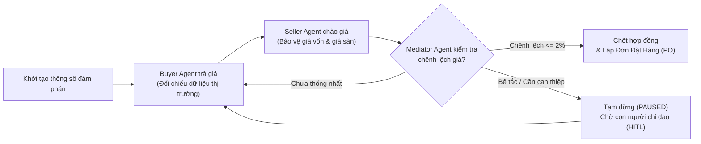
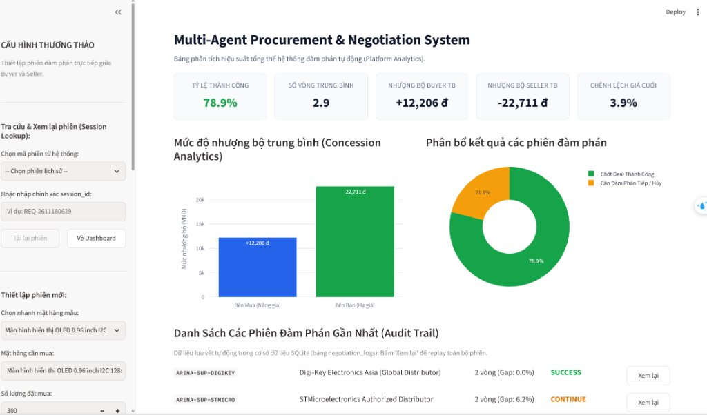
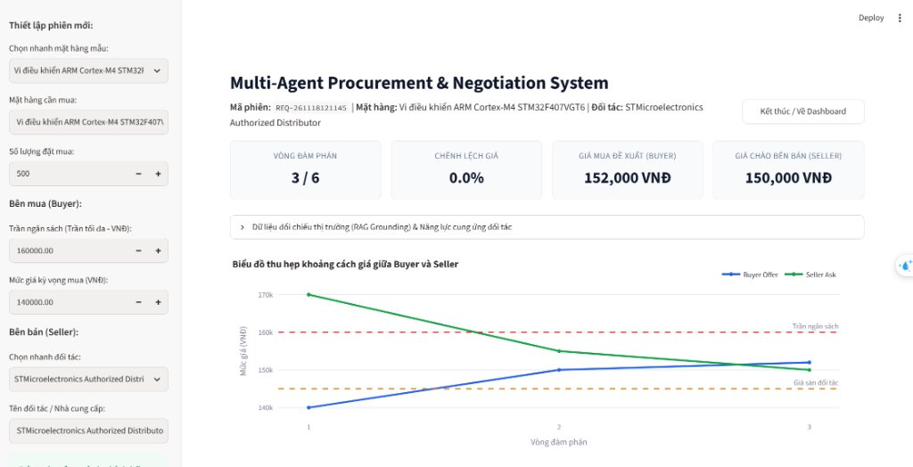
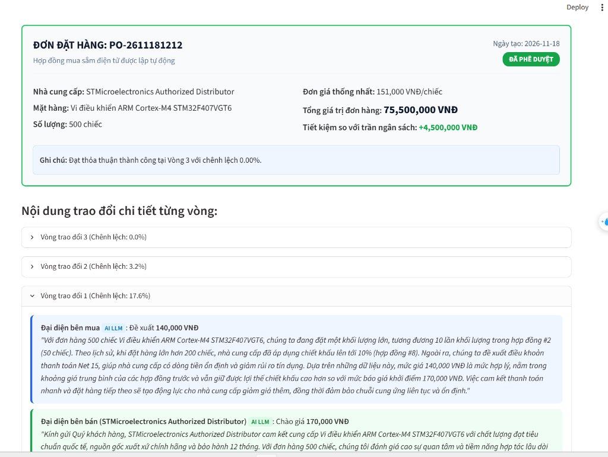
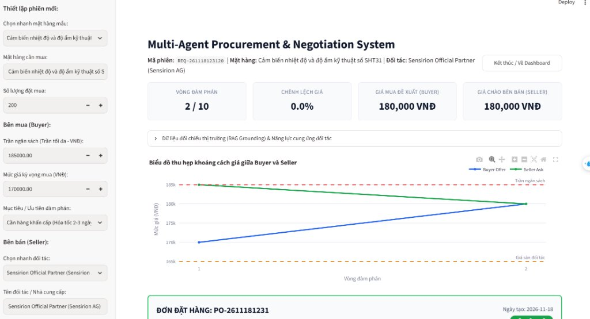
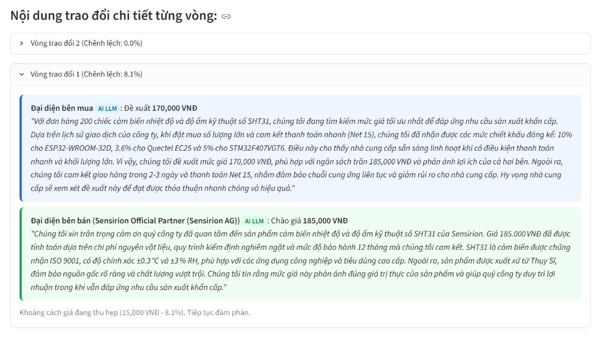
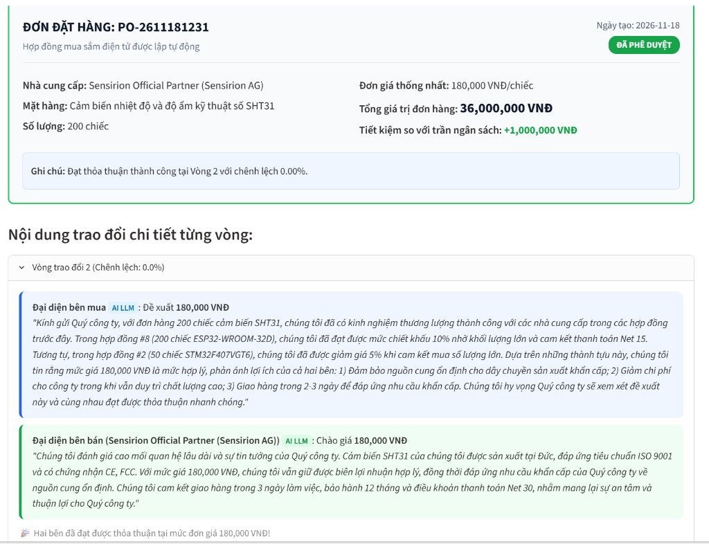
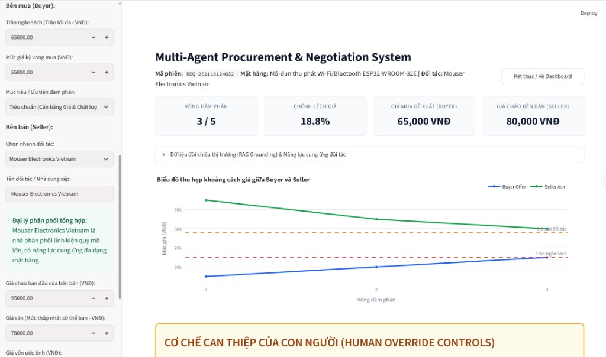
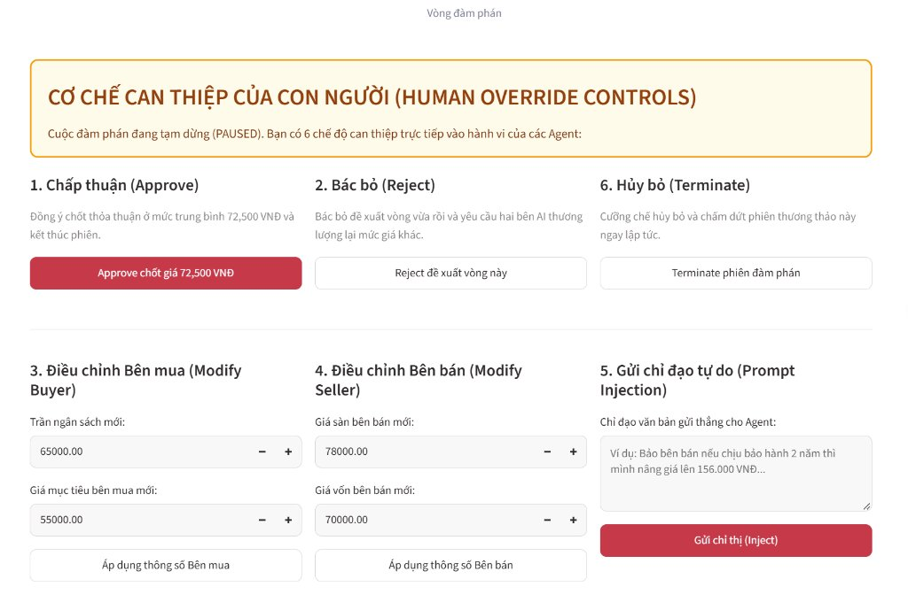

# Autonomous Multi-Agent Procurement & Negotiation System

Hệ thống Multi-Agent giúp doanh nghiệp tự động hóa quá trình đàm phán giá mua sắm B2B, tiết kiệm chi phí thu mua, rút ngắn thời gian chốt hợp đồng và cho phép con người kiểm soát linh hoạt.

---

## 1. Cơ Chế Đàm Phán Cốt Lõi (Buyer ⇄ Seller ⇄ Mediator)

Hệ thống vận hành theo vòng lặp đàm phán 3 tác tử:

* **Buyer Agent (Đại diện bên mua):** Đưa ra mức giá kỳ vọng, sử dụng RAG đối chiếu hợp đồng quá khứ để ép giá và tận dụng điều khoản thanh toán nhanh để lấy chiết khấu. Tuyệt đối không vượt trần ngân sách.
* **Seller Agent (Đại diện bên bán):** Chào giá bán, bảo vệ biên lợi nhuận, cam kết thời gian giao hàng và chất lượng. Tuyệt đối không bán dưới giá sàn và giá vốn.
* **Mediator Agent (Trọng tài đàm phán):** Đánh giá mức chênh lệch giá (Price Gap %) qua từng vòng. Khi mức chênh lệch thu hẹp nhỏ hơn hoặc bằng 2%, Mediator tự động chốt deal và lập Đơn Đặt Hàng (PO). Nếu đàm phán bế tắc hoặc chạm ngưỡng, Mediator tạm dừng (PAUSED) để con người can thiệp.



---

## 2. Các Tính Năng Nâng Cao Quan Trọng

### 2.1. Cơ chế can thiệp nâng cao của con người (Human Override Controls)
Khi cuộc đàm phán tạm dừng (PAUSED), người quản trị có tới 6 chế độ can thiệp trực tiếp:
1. **approve:** Đồng ý với xu hướng giá hiện tại và ký duyệt chốt hợp đồng ngay lập tức.
2. **reject:** Bác bỏ đề xuất vòng vừa rồi và yêu cầu hai bên AI thương lượng lại mức giá khác.
3. **modify_buyer:** Điều chỉnh trực tiếp trần ngân sách (budget_ceiling) hoặc giá mục tiêu của bên mua ngay giữa chừng.
4. **modify_seller:** Điều chỉnh giá sàn (minimum_price) hoặc giá vốn của bên bán.
5. **inject (Prompt Injection):** Nhập chỉ thị tự do bằng văn bản gửi thẳng vào cho Agent (ví dụ: *"Bảo bên bán nếu chịu bảo hành 2 năm thì mình nâng giá lên 156.000 VNĐ"*).
6. **terminate:** Cưỡng chế hủy bỏ phiên đàm phán ngay lập tức.

### 2.2. Tra cứu & Xem lại lịch sử (Session Lookup & Replay)
* Mỗi phiên đàm phán đều có một mã `session_id` riêng biệt và được lưu vết toàn bộ trong cơ sở dữ liệu SQLite (`negotiation_logs`).
* Người dùng có thể chọn hoặc nhập mã `session_id` ở thanh bên trái để tải lại toàn bộ tiến trình của phiên cũ.
* Xem chi tiết từng vòng: diễn biến biểu đồ giá, tỷ lệ chênh lệch giá, lý do suy luận (reasoning) của từng bên và các quyết định can thiệp.

### 2.3. Bảng phân tích hiệu suất tổng thể (Platform Analytics Dashboard)
Khi không có phiên nào đang chạy, màn hình chính đóng vai trò là một Analytics Dashboard tự động tổng hợp số liệu thực tế từ SQLite:
* **Tỷ lệ thành công (Success Rate %):** Tỷ lệ các phiên đạt được thỏa thuận chốt hợp đồng.
* **Số vòng trung bình (Avg. Rounds):** Số vòng trung bình để hai bên đạt được tiếng nói chung.
* **Mức độ nhượng bộ trung bình (Concession Analytics):**
  * *Avg. Buyer Concession:* Mức giá trung bình bên mua đã chịu nâng lên so với mức mở đầu.
  * *Avg. Seller Concession:* Mức giá trung bình bên bán đã chịu hạ xuống so với mức mở đầu.
* **Price Gap %:** Mức độ thu hẹp khoảng cách giá trước khi đạt thỏa thuận.
* **Audit Trail:** Bảng danh sách các phiên đàm phán gần nhất kèm nút xem lại nhanh từng phiên.


*Hình: Dashboard phân tích KPI hiệu suất hệ thống và Danh sách kiểm toán (Audit Trail).*

---

## 3. Các Kịch Bản Kiểm Thử Thực Tế

### Kịch bản 1: Mua sắm thông thường (Tự động thương thảo & Chốt giá)
* **Tình huống:** Mua linh kiện bán dẫn. Hai bên đàm phán thu hẹp khoảng cách giá qua từng vòng và tự động chốt deal khi chênh lệch dưới 2%.




---

### Kịch bản 2: Cần hàng khẩn cấp cứu dây chuyền sản xuất (Emergency Line-Down)
* **Tình huống:** Cần gấp cảm biến nhiệt trong 3 ngày. Bên mua chủ động nâng giá mua để đổi lấy cam kết giao hàng hỏa tốc.
* **Diễn biến:**
  * Lượt 1: Buyer đề xuất giá 170,000 VNĐ kèm dẫn chứng hợp đồng cũ và yêu cầu giao gấp trong 2–3 ngày; Seller chào giá 185,000 VNĐ.
  * Lượt 2: Buyer chủ động nâng lên 180,000 VNĐ để cứu dây chuyền; Seller chấp thuận khớp giá 180,000 VNĐ và cam kết giao hàng hỏa tốc trong 3 ngày.


*Hình 1: Thiết lập chế độ Cần hàng khẩn cấp và biểu đồ hội tụ giá sau 2 vòng.*


*Hình 2: Buyer Agent viện dẫn hợp đồng quá khứ và yêu cầu giao hỏa tốc 2-3 ngày.*


*Hình 3: Hai bên khớp giá 180,000 VNĐ, cam kết giao hàng 3 ngày và tự động lập Đơn Đặt Hàng PO.*

---

### Kịch bản 3: Xử lý bế tắc & Ngân sách không khả thi (Deadlock Handling)
* **Tình huống:** Trần ngân sách bên mua (65,000 VNĐ) thấp hơn giá sàn bên bán (78,000 VNĐ) khiến vùng thỏa hiệp ZOPA bị âm.
* **Kết quả:** Mediator Agent phát hiện hai bên chạm ngưỡng giới hạn mà không thể thu hẹp thêm khoảng cách (18.8%), tự động chuyển trạng thái sang `PAUSED` và mở Bảng điều hành Human Override để Quản lý can thiệp.


*Hình 1: Biểu đồ thể hiện Buyer chạm trần ngân sách 65k và Seller chạm giá sàn 78k, đàm phán bế tắc.*


*Hình 2: Bảng can thiệp cho phép Quản lý chọn 6 chế độ can thiệp (Chấp thuận, Bác bỏ, Điều chỉnh trần/sàn, Gửi chỉ đạo tự do, Hủy bỏ).*

---

## 4. Hướng Dẫn Cài Đặt & Chạy Ứng Dụng

### 1. Cài đặt môi trường:
Yêu cầu Python 3.10 trở lên:
```bash
pip install -r requirements.txt
pip install streamlit plotly
```

### 2. Chạy kiểm thử tự động toàn bộ kịch bản:
```bash
$env:PYTHONPATH="d:\MultiAgent"; python tests/test_usecases.py
```
*(Kết quả: Toàn bộ các ca kiểm thử chiến lược vượt qua 100%).*

### 3. Mở giao diện Web (Streamlit):
```bash
streamlit run app/ui/app.py
```
Mở trình duyệt tại: `http://localhost:8501`

---

## 5. Cấu Trúc Dự Án Tinh Gọn

```text
d:/MultiAgent/
├── app/
│   ├── models/schemas.py        # Định dạng dữ liệu: Báo giá, Đơn đặt hàng (PO), Quyết định trọng tài
│   ├── graph/
│   │   ├── workflow.py          # State Machine tuần hoàn 3 Agent (Buyer - Seller - Mediator)
│   │   ├── master_workflow.py   # Quy trình tổng thể tích hợp kiểm thử 3 kịch bản
│   │   └── state.py             # Trạng thái luân chuyển đàm phán (NegotiationState)
│   ├── agents/
│   │   ├── buyer.py             # Đại diện bên mua (tra cứu giá quá khứ, ép giá, nhận chỉ đạo inject)
│   │   ├── seller.py            # Đại diện bên bán (bảo vệ giá vốn & giá sàn tối thiểu)
│   │   └── mediator.py          # Trọng tài đàm phán (tính Gap %, kích hoạt PAUSED & 6 chế độ Override)
│   ├── memory/vector_store.py   # Tra cứu hợp đồng lịch sử thị trường (ChromaDB)
│   ├── data/database.py         # Quản lý SQLite: lưu vết negotiation_logs và hàm tính Platform Analytics
│   └── ui/app.py                # Giao diện Web: Live Arena, 6 Human Overrides, Session Replay, Analytics
├── docs/images/                 # Hình ảnh chụp demo thực tế các kịch bản
├── tests/test_usecases.py       # Bộ kiểm thử tự động 3 kịch bản
├── requirements.txt             # Thư viện phụ thuộc
└── README.md                    # Tài liệu hướng dẫn dự án
```
